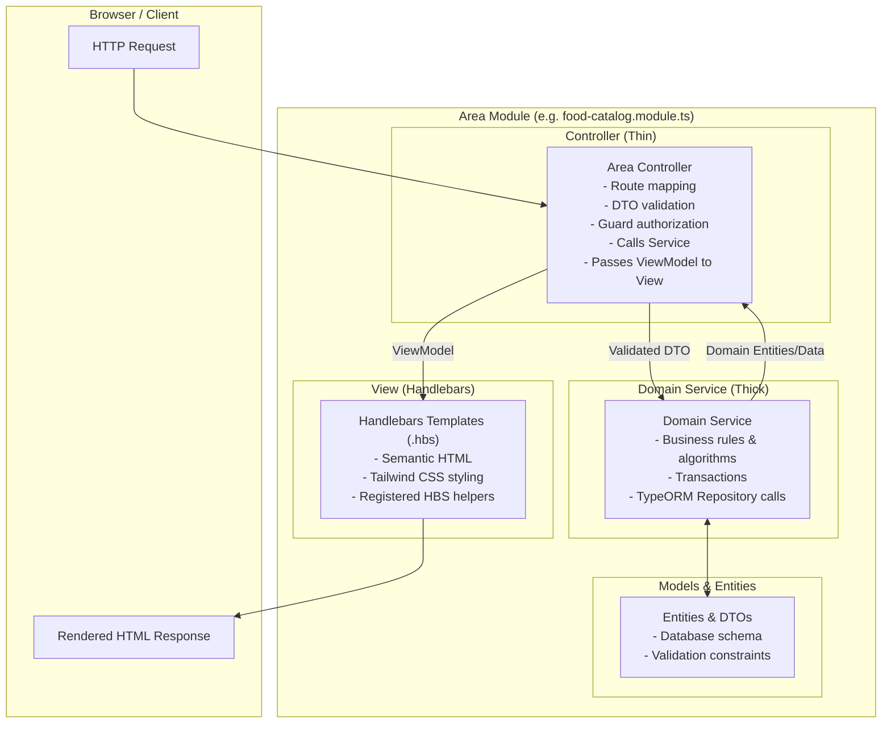
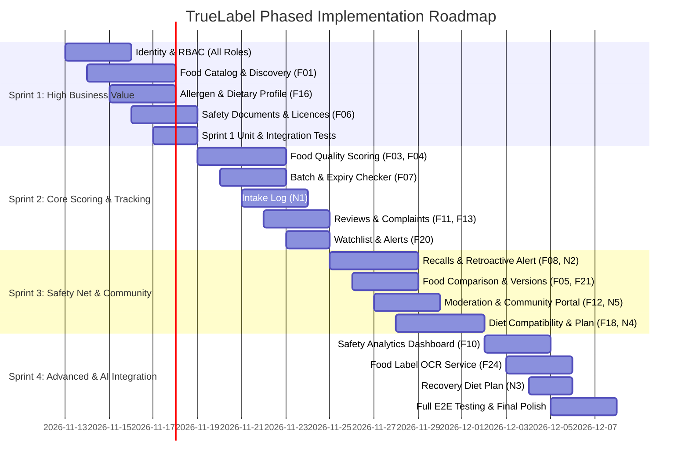

# TrueLabel — Implementation Plan & MVC Architecture Blueprint

## 1. Executive Summary & Proposal Analysis

### 1.1. Project Context & Objectives
**TrueLabel** is an explainable food quality, safety, and dietary platform built to solve critical consumer pain points:
- Packaged food labels are obscure, deceptive, or difficult to interpret.
- Harmful allergens and unsafe additives are frequently overlooked.
- Expiries, counterfeit goods, and recalled batches pose immediate health risks with zero proactive alerts for past consumers.
- Consumer reviews are unstructured and prone to fake ratings.

TrueLabel solves this through:
1. **Explainable 0–100 Food Quality Score** with transparent component weights.
2. **Personalized Allergen & Nutrition Profiling** with immediate warnings and compatibility checks.
3. **Traceable Food Safety Records**: Batch checking, verified manufacturer documents, inspector-issued recalls.
4. **Retroactive Harmful Intake Alerts**: Automatically alerting consumers who logged consuming recalled or flagged batches.
5. **Rule-Based Dietary Planning**: Weekly plans and recovery diet plans grounded in catalog foods and Mifflin-St Jeor calculations.

### 1.2. Stakeholder Roles & Access Boundaries
| Role | Access Scope | Strict Boundaries |
| :--- | :--- | :--- |
| **Guest** | Search & browse catalog, inspect scores/breakdowns, read community posts & blog | Cannot review, report, save foods, log intake, or personalize warnings |
| **Consumer** | All guest permissions + preference/allergy profile, comparison, reviews, reports, intake log, diet plans, watchlist | Cannot edit product records, scoring rules, or official documents |
| **Manufacturer** | Create/manage own food products, batches, upload licences & lab documents, reply to reviews | Cannot modify other manufacturers' foods or approve own documents |
| **Inspector / Expert** | Review documents, investigate complaint reports, issue recalls, answer Q&A with expert badge | Cannot adjust scoring weights or modify user accounts |
| **Admin** | User/role management, food rules, scoring weights, diet templates, moderation queue, blog publishing | All actions logged; cannot approve inspector documents without audit trail |

---

## 2. Strict MVC Protocol & Area Folder Structure

### 2.1. Alignment with Lecture Slide Architecture
The lecture slide demonstrates standard **ASP.NET MVC Areas**:
```
StandardFolderStructure
├── Areas/
│   ├── Electronics/
│   │   ├── Controllers/
│   │   │   ├── CamerasController.cs
│   │   │   └── MobilesController.cs
│   │   ├── Models/
│   │   │   ├── CameraAccessoryDto.cs
│   │   │   └── CameraDto.cs
│   │   ├── Views/
│   │   │   ├── Cameras/ (Accessories.cshtml, Index.cshtml)
│   │   │   └── Shared/ (_Layout.cshtml, _ViewStart.cshtml)
│   │   └── ElectronicsAreaRegistration.cs
│   └── Fashion/
```

We map this **1:1** into the **NestJS + Handlebars** server-rendered architecture defined in `TrueLabel_Project_Proposal.md`:

```
truelabel-food/
├── src/
│   ├── main.ts                        # Bootstrap & Handlebars setup
│   ├── app.module.ts                  # Root NestJS module importing Area modules
│   ├── config/                        # Database, session, environment configs
│   ├── common/                        # Common guards, filters, pipes, decorators
│   ├── areas/                         # Modular MVC Areas
│   │   ├── identity/                  # Accounts, login, sessions, roles
│   │   ├── food-catalog/              # Catalog, discovery, scoring, comparison
│   │   ├── personal-food/             # Preferences, allergies, watchlist
│   │   ├── food-safety/               # Batches, documents, recalls, alerts
│   │   ├── diet/                      # Intake log, recovery, diet plans
│   │   ├── community/                 # Reviews, reports, moderation, expert feed
│   │   ├── content/                   # Blog/vlog posts, educational content
│   │   └── admin/                     # Food rules, diet templates, analytics
│   └── shared/
│       └── views/                     # Master layout & global partials
├── public/                            # Static Tailwind CSS, images, client scripts
├── test/                              # End-to-end integration tests
└── ocr-service/                       # Isolated Python OCR microservice
```

### 2.2. Architectural Layer Responsibilities


- **Controller**: Ultra-thin (~15–25 lines per endpoint). Validates inputs via class-validator DTOs, checks `@UseGuards()`, delegates work to domain services, passes data to `@Render('view')` or redirects.
- **Service & Model**: Owns business logic, calculations, and data persistence. Pure TypeScript, completely decoupled from HTTP objects (`Request`/`Response`) and template rendering.
- **View**: Server-rendered Handlebars templates (`.hbs`) receiving clean ViewModel data. Strictly zero database queries or business decisions in views.

---

## 3. Sprint Roadmap & Phased Execution

To maximize delivery and deliver immediate business utility, we prioritize **High Business Value Features First** in Sprint 1, establishing solid foundations for gradual feature expansion.



### 3.1. Sprint 1 Scope: High Business Value Core

| Priority | Feature ID | Feature Name | Area | Key Capabilities Delivered |
| :---: | :---: | :--- | :--- | :--- |
| **P1** | **Shared** | **Identity & RBAC System** | `identity` | Multi-role registration & login (Guest, Consumer, Manufacturer, Inspector, Admin), bcrypt password hashing, session guards, master layouts. |
| **P1** | **F01** | **Food Catalog Management & Discovery** | `food-catalog` | Manufacturer/Admin food creation & editing, duplicate barcode rejection, full-text search by name/brand/barcode, multi-attribute filtering (category, dietary tags, score range), food detail view with ingredient and nutrition breakdowns. |
| **P1** | **F16** | **Food Preference & Allergen Profile** | `personal-food` | Consumer personal profile setup (allergies, dietary preferences, nutrition goals, body metrics). Dynamic conflict detection highlighting allergen warnings directly on catalog food pages. |
| **P2** | **F06** | **Licence & Document Foundation** | `food-safety` | Manufacturer licence number verification against demo registry, safety document upload (certificate/lab test), document review state machine (`pending` → `approved`/`rejected`). |
| **P2** | **F11/F13**| **Review & Complaint Data Models** | `community` | Core entity schemas and repository foundations for consumer reviews and incident reporting. |

---

## 4. Technical Specifications for Sprint 1

### 4.1. Data Models & Entities
1. **`User`** (`identity` Area):
   - `id`, `name`, `email` (unique), `passwordHash`, `role` (`consumer`, `manufacturer`, `inspector`, `admin`), `accountAgeDays`, `isVerified`, `createdAt`, `updatedAt`.
2. **`Manufacturer`** (`food-catalog` Area):
   - `id`, `userId` (FK to User), `companyName`, `licenceNumber`, `verificationStatus` (`unverified`, `verified`, `expired`), `createdAt`.
3. **`FoodProduct`** (`food-catalog` Area):
   - `id`, `manufacturerId` (FK), `name`, `brand`, `category`, `barcode` (unique, indexed), `imageUrl`, `description`, `servingSize`, `servingUnit`, `status` (`active`, `archived`), `currentScore` (provisional 0–100), `createdAt`, `updatedAt`.
4. **`Ingredient`** (`food-catalog` Area):
   - `id`, `foodProductId` (FK), `name`, `isAllergen`, `allergenType`, `additiveCode` (e.g., E-numbers), `hazardLevel` (`safe`, `caution`, `warning`), `rawText`.
5. **`NutritionFact`** (`food-catalog` Area):
   - `id`, `foodProductId` (FK), `nutrient` (`energy`, `fat`, `saturatedFat`, `sugars`, `salt`, `fiber`, `protein`), `amountPer100g`, `amountPerServing`, `unit`.
6. **`FoodPreferenceProfile`** (`personal-food` Area):
   - `id`, `userId` (FK, unique), `allergies` (string array: peanuts, milk, gluten, soy, etc.), `dietaryPreferences` (vegetarian, vegan, halal, kosher, low-sodium), `dailyCalorieTarget`, `dailySugarLimit`, `dailySodiumLimit`, `weightKg`, `heightCm`, `age`, `sex`, `activityLevel`.
7. **`FoodSafetyDocument`** (`food-safety` Area):
   - `id`, `manufacturerId` (FK), `documentType` (`halal`, `iso22000`, `lab_test`, `trade_licence`), `certificateNumber`, `issuer`, `issueDate`, `expiryDate`, `fileUrl`, `status` (`pending`, `approved`, `rejected`), `rejectionReason`, `reviewedBy` (FK to User).

### 4.2. Controllers & Views Structure
- **`IdentityArea`**:
  - `AuthController` -> `GET /auth/login`, `POST /auth/login`, `GET /auth/register`, `POST /auth/register`, `POST /auth/logout`
  - Views: `areas/identity/views/login.hbs`, `register.hbs`
- **`FoodCatalogArea`**:
  - `FoodCatalogController` -> `GET /catalog` (search & filter), `GET /catalog/:id` (detail), `GET /catalog/manage/create` (form), `POST /catalog/manage` (create), `GET /catalog/manage/:id/edit` (edit form), `POST /catalog/manage/:id` (update), `POST /catalog/manage/:id/archive`
  - Views: `areas/food-catalog/views/index.hbs`, `detail.hbs`, `create.hbs`, `edit.hbs`
- **`PersonalFoodArea`**:
  - `PreferenceProfileController` -> `GET /profile/preferences`, `POST /profile/preferences`
  - Views: `areas/personal-food/views/profile.hbs`
- **`FoodSafetyArea`**:
  - `SafetyDocumentController` -> `GET /safety/documents`, `POST /safety/documents/upload`, `POST /safety/documents/:id/review` (Inspector only)
  - Views: `areas/food-safety/views/documents.hbs`

---

## 5. Mandatory Unit Testing Strategy

In compliance with our engineering protocol, **every single service method and controller action will have a corresponding unit test file** testing:
1. **Happy Path**: Successful creation, retrieval, search filtering, and state transitions.
2. **Business Rule Enforcement**:
   - Barcode uniqueness: rejects duplicates with `ConflictException`.
   - Access control: Manufacturer cannot edit another manufacturer's food product (`ForbiddenException`).
   - Profile conflict detection: Accurately flags food products containing allergens matching user profile.
   - Inspector review: Rejecting a document requires a valid rejection reason.
3. **Edge Cases**:
   - Null or missing ingredients.
   - Barcode search with non-existent barcode returns 404 or custom request-to-add view.
   - Unknown allergens gracefully labeled without crashing.

### 5.1. Test Matrix for Sprint 1
| Component | Test File | Test Cases |
| :--- | :--- | :--- |
| `AuthService` | `src/areas/identity/services/auth.service.spec.ts` | Register new user, duplicate email rejection, password hashing verification, login validation with correct/incorrect password. |
| `CatalogService` | `src/areas/food-catalog/services/catalog.service.spec.ts` | Create product with ingredients & nutrition, duplicate barcode rejection, filter by category and dietary tags, search by barcode, manufacturer ownership check on update/archive. |
| `PreferenceService` | `src/areas/personal-food/services/preference.service.spec.ts` | Create profile, update profile, detect allergen conflict between food ingredients and user profile (exact and partial matches). |
| `DocumentService` | `src/areas/food-safety/services/document.service.spec.ts` | Upload document, transition pending -> approved, transition pending -> rejected (validating rejection reason presence), flag documents expiring in 30 days. |

---

## 6. Execution Plan & Next Steps

1. **Step 1: Workspace Initialization**
   - Initialize NestJS project structure with TypeScript, Handlebars view engine configuration, TypeORM with SQLite/PostgreSQL configuration.
   - Set up Tailwind CSS for server-rendered Handlebars views.
2. **Step 2: Core Common Layer**
   - Build Session Auth, Passport local strategy, Role guards (`@Roles('consumer', 'manufacturer', 'inspector', 'admin')`), CurrentUser decorator, and validation pipes.
   - Master Handlebars layout (`main.hbs`), navigation header, footer, alert toast partials.
3. **Step 3: Identity Area Implementation**
   - Implement `User` entity, `AuthService`, `AuthController`, login and registration views with unit tests.
4. **Step 4: Food Catalog Area Implementation (High Business Value - F01)**
   - Implement `FoodProduct`, `Ingredient`, `NutritionFact` entities.
   - Implement `CatalogService` with barcode search, category filter, dietary tags filter, and ownership verification.
   - Implement `FoodCatalogController` and Handlebars views (`index.hbs`, `detail.hbs`, `create.hbs`).
   - Write comprehensive unit tests for `CatalogService` and `FoodCatalogController`.
5. **Step 5: Personal Food Area Implementation (High Business Value - F16)**
   - Implement `FoodPreferenceProfile` entity.
   - Implement `PreferenceService` with allergen matching logic.
   - Connect allergen warning badges onto the Food Catalog detail view.
   - Write unit tests for preference creation, updates, and allergen conflict matching.
6. **Step 6: Food Safety Area Foundation (F06)**
   - Implement `FoodSafetyDocument` entity and `DocumentService` with review state machine.
   - Write unit tests verifying document state transitions.
7. **Step 7: Verification & Test Execution**
   - Run `npm test` to verify all test suites pass with 100% success.
   - Document all steps in `DEVELOPMENT_LOG.md`.

