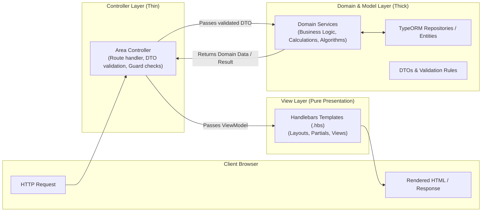

# TrueLabel Project Rules & Engineering Protocol

> **CRITICAL DIRECTIVE**: This document defines the non-negotiable architectural, coding, testing, and documentation standards for the **TrueLabel** platform. All code additions, refactoring, and contributions must strictly comply with these rules.

---

## 0. AI Agent & Developer Onboarding Protocol (First-Time Setup)

When anyone (developer or AI agent) starts working on this project for the first time, the AI agent must strictly follow this initialization procedure upon the initial prompt/session:

1. **Mandatory Skill Verification & Automatic Installation**:
   - The AI agent **must automatically check** whether the `frontend-design` skill is installed in the project (under `.agents/skills/frontend-design/` or in the agent's available skills).
   - If the skill is not installed or missing, the AI agent **must automatically execute the installation command**:
     ```bash
     npx skills add https://github.com/anthropics/skills --skill frontend-design
     ```
2. **Fallback Notification Directive**:
   - If the automatic installation cannot be executed or fails (e.g., due to sandbox/network restrictions or missing CLI binaries), the AI agent **must immediately instruct the user** to install it manually by running:
     ```bash
     npx skills add https://github.com/anthropics/skills --skill frontend-design
     ```

---

## 1. Strict MVC Protocol & Boundary Enforcement

The system follows a strict **Model-View-Controller (MVC)** architectural design. Cross-layer leakage is strictly prohibited.



### 1.1. The Controller Layer (`Controllers/`)
* **Role**: Acts purely as the traffic conductor between incoming HTTP requests and internal domain services.
* **Responsibilities**:
  1. Routing HTTP GET, POST, PUT, DELETE requests.
  2. Enforcing Authentication and Role Guards (`@UseGuards(AuthenticatedGuard, RolesGuard)`).
  3. Validating incoming payloads using class-validator DTOs (`@UsePipes(ValidationPipe)`).
  4. Delegating business logic exclusively to Domain Services.
  5. Selecting the view to render (`@Render('view-path')`) with a clean ViewModel or issuing an HTTP Redirect.
* **Prohibitions**:
  - **NO direct database queries** (No TypeORM repository calls inside controllers).
  - **NO business logic calculations** (e.g., score computation, diet calculations, allergen matching must NOT exist in controllers).
  - **Maximum method length**: ~15–25 lines.

### 1.2. The Model & Service Layer (`Models/` & `Services/`)
* **Role**: Owns all domain state, entities, validation rules, data access, and business algorithms.
* **Responsibilities**:
  1. **Entities**: Define database schema, relations, foreign keys, and column constraints using TypeORM.
  2. **DTOs (Data Transfer Objects)**: Strictly type and validate input and output data using `class-validator` and `class-transformer`.
  3. **Domain Services**: Implement algorithms (e.g., 0–100 Food Quality Score, Mifflin-St Jeor diet formulas, retroactive intake scans, allergen detection).
  4. **Data Access**: Perform database queries, transactions, and mutations via injected repositories.
* **Prohibitions**:
  - **Zero awareness of HTTP**: Services must never import `@Req()`, `@Res()`, `Request`, or `Response` objects.
  - **Zero awareness of View rendering**: Services return typed plain TypeScript objects/entities, never HTML strings or template names.

### 1.3. The View Layer (`Views/`)
* **Role**: Pure presentation layer rendered server-side using Handlebars (`.hbs`).
* **Responsibilities**:
  1. Render server-side HTML pages and partials.
  2. Format displayed data (e.g., date formatting, score badge colors, allergen tags) using registered Handlebars helpers.
  3. Follow responsive design with Tailwind CSS.
* **Prohibitions**:
  - **Zero business decisions**: Views must only inspect pre-calculated flags and values provided by the controller ViewModel.
  - **Zero data mutations or API calls to fetch core page data**: Everything required to render the view must be supplied by the controller.

---

## 2. Area-Based Folder Structure (Sensitivity & Standards)

The project strictly follows the **ASP.NET MVC Areas pattern adapted for NestJS**, matching both the course lecture specification (demonstrated in Visual Studio Solution Explorer) and Section "MVC architecture and folder structure" of the Project Proposal.

### 2.1. Directory Structure Mapping

```
TrueLabel/
├── src/
│   ├── main.ts                        # Application bootstrap & Handlebars engine setup
│   ├── app.module.ts                  # Root application module registering all Area modules
│   ├── config/                        # Database, session, environment configuration
│   ├── common/                        # Cross-cutting concerns: guards, filters, pipes, decorators
│   │   ├── guards/                    # AuthGuard, RolesGuard
│   │   ├── filters/                   # HttpExceptionFilter
│   │   ├── pipes/                     # Custom validation pipes
│   │   └── decorators/                # @CurrentUser(), @Roles()
│   ├── areas/                         # Self-contained MVC Feature Areas
│   │   ├── identity/                  # Area 1: User auth, registration, roles, session
│   │   │   ├── controllers/           # AuthController, ProfileController
│   │   │   ├── models/                # User entity, LoginDto, RegisterDto, UserViewModel
│   │   │   ├── services/              # AuthService, PasswordService
│   │   │   ├── views/                 # login.hbs, register.hbs
│   │   │   └── identity.module.ts     # Area Module Registration
│   │   ├── food-catalog/              # Area 2: Product discovery, catalog management, scoring
│   │   │   ├── controllers/           # FoodCatalogController, FoodComparisonController
│   │   │   ├── models/                # FoodProduct, Ingredient, NutritionFact entities & DTOs
│   │   │   ├── services/              # CatalogService, ScoringService, IngredientRuleService
│   │   │   ├── views/                 # index.hbs, detail.hbs, create.hbs, compare.hbs
│   │   │   └── food-catalog.module.ts # Area Module Registration
│   │   ├── personal-food/             # Area 3: Personalization, allergen profile, watchlist
│   │   │   ├── controllers/           # PreferenceController, WatchlistController
│   │   │   ├── models/                # PreferenceProfile entity, ProfileDto
│   │   │   ├── services/              # PreferenceService, WatchlistService
│   │   │   ├── views/                 # profile.hbs, watchlist.hbs
│   │   │   └── personal-food.module.ts# Area Module Registration
│   │   ├── food-safety/               # Area 4: Batches, certification, recalls, safety alerts
│   │   │   ├── controllers/           # SafetyController, RecallController
│   │   │   ├── models/                # FoodBatch, FoodAlert, Document entities & DTOs
│   │   │   ├── services/              # BatchService, RecallService, DocumentService
│   │   │   ├── views/                 # check-batch.hbs, alerts.hbs, documents.hbs
│   │   │   └── food-safety.module.ts  # Area Module Registration
│   │   ├── diet/                      # Area 5: Intake logs, recovery plans, overall diet plans
│   │   │   ├── controllers/           # IntakeController, DietPlanController
│   │   │   ├── models/                # IntakeLog, DietPlan entities & DTOs
│   │   │   ├── services/              # IntakeService, DietCalculationService, HarmfulIntakeService
│   │   │   ├── views/                 # log.hbs, plan.hbs, recovery.hbs
│   │   │   └── diet.module.ts         # Area Module Registration
│   │   ├── community/                 # Area 6: Reviews, reports, moderation, expert portal
│   │   │   ├── controllers/           # ReviewController, ReportController, CommunityController
│   │   │   ├── models/                # FoodReview, FoodReport, CommunityPost entities & DTOs
│   │   │   ├── services/              # ReviewService, ReportService, ModerationService
│   │   │   ├── views/                 # reviews.hbs, report-form.hbs, feed.hbs
│   │   │   └── community.module.ts    # Area Module Registration
│   │   ├── content/                   # Area 7: Blog, vlog, educational content (N6)
│   │   │   ├── controllers/           # BlogController
│   │   │   ├── models/                # BlogPost, BlogCategory entities & DTOs
│   │   │   ├── services/              # BlogService
│   │   │   ├── views/                 # index.hbs, article.hbs
│   │   │   └── content.module.ts      # Area Module Registration
│   │   └── admin/                     # Area 8: Food rules, diet templates, analytics
│   │       ├── controllers/           # AdminRulesController, AnalyticsController
│   │       ├── models/                # FoodRule, DietTemplate entities & DTOs
│   │       ├── services/              # RuleManagementService, AnalyticsService
│   │       ├── views/                 # dashboard.hbs, rules.hbs, templates.hbs
│   │       └── admin.module.ts        # Area Module Registration
│   └── shared/
│       └── views/                     # Global layouts and partials
│           ├── layouts/               # main.hbs, auth.hbs, admin.hbs
│           └── partials/              # _navbar.hbs, _footer.hbs, _alerts.hbs, _score-badge.hbs
├── public/                            # Static assets: compiled Tailwind CSS, client JS, images
├── test/                              # End-to-end (E2E) integration test suites
└── ocr-service/                       # Isolated Python service for OCR text extraction
```

### 2.2. Strict Area Module Encapsulation Rule
Each Area directory **must** contain an `<area-name>.module.ts` that acts as the Area Registration file (identical in purpose to the `AreaRegistration.cs` file in the lecture slide). It explicitly declares:
- The Area's Controllers
- The Area's Services (Providers)
- Imported TypeORM Entities for that Area
- Exported Services required by other Areas (via Dependency Injection)

---

## 3. Mandatory Unit Testing & Verification Rules

Every single function and service written for this project **MUST** be accompanied by unit tests. No code is considered done without passing tests.

### 3.1. Testing Rules & Standards
1. **Collocated Test Files**:
   - Every service file `foo.service.ts` must have a corresponding `foo.service.spec.ts` in the same directory.
   - Every controller file `foo.controller.ts` must have a corresponding `foo.controller.spec.ts`.
2. **Arrange-Act-Assert (AAA) Pattern**:
   - Every test case must follow the AAA structure clearly:
     - **Arrange**: Set up mocks, DTO inputs, test state.
     - **Act**: Call the method under test.
     - **Assert**: Verify return values, state changes, mock call parameters, and thrown exceptions.
3. **Isolation through Mocking**:
   - Unit tests must **never** connect to a real database.
   - Use Jest mock objects (`jest.fn()`, `Repository<T>` mocks) for all repository and external service dependencies.
4. **Mandatory Edge Case Testing**:
   - Standard happy path.
   - Validation failure / malformed DTO.
   - Entity not found (throw NotFoundException).
   - Duplicate key / collision (throw ConflictException).
   - Unauthorized / forbidden access (throw ForbiddenException / UnauthorizedException).
   - Boundary values (e.g., scores 0, 100, out of bounds; empty ingredient lists; zero portions).
5. **Execution Verification**:
   - All tests must execute cleanly with zero failures via `npm test`.

---

## 4. Documentation & Traceability Protocol

1. **Chronological Tracking with Mandatory Timestamps**: Maintain `DEVELOPMENT_LOG.md` recording all architectural choices, feature implementations, and test outcomes. **Every entry MUST include the exact date, time, and timezone** (e.g., `YYYY-MM-DD HH:MM:SS +06:00`). Entries must record:
   - Timestamp (Date and Time)
   - Action / Task performed
   - Feature ID / Component impacted
   - Test execution & verification outcome
2. **Feature Traceability**: Every entity, controller action, and service method must cite the corresponding Feature ID from `TrueLabel_Project_Proposal.md` (e.g., `// Feature F01: Food catalog management`).
3. **Medical & Food Safety Disclaimers**: All user-facing views providing nutritional advice, allergen warnings, or quality scores must display standard informational disclaimers in accordance with Section Non-functional requirements of the proposal.

---

## 5. Sprint 1 Business Value Prioritization

In accordance with user directives, development begins with **High Business Value Features First**:

1. **Foundation & Security**:
   - `identity` Area: User authentication, password hashing, session management, and RBAC guards (Admin, Consumer, Manufacturer, Inspector).
2. **Core Customer Value (Catalog Discovery - F01)**:
   - `food-catalog` Area: Food products, ingredients, nutrition facts, search by name/barcode, filter by category/dietary tags, and product detail views.
3. **Personalized Health Value (Allergen & Preference Profile - F16)**:
   - `personal-food` Area: User allergy & dietary profile setup, persistent profile storage, and active conflict warning flags on food items.
4. **Accountable Industry Value (Manufacturer & Safety Foundation - F06)**:
   - `food-safety` Area: Manufacturer licence verification, food safety document submission, and verification status state machine.

